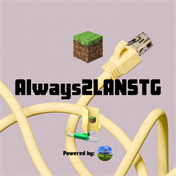

<p align="center">
  
</p>

# Always2LANSTG

**STG SERIES** Fabric mod that turns Minecraft’s own **Open to LAN** on automatically when you load a world.

It does not run a custom LAN server. It only controls vanilla Open to LAN: the same `publishServer` / `unpublishServer` path as the pause-menu Multiplayer Options / Open to LAN screen.

Author: [STGHECKER](https://github.com/stghecker)  
License: [MIT](LICENSE)

## Features

- Per-world **ON/OFF** and **port** (saved as `always2lanstg.json` in the world folder)
- New worlds default to **OFF**, port **25565**
- Create World → Game tab: Always2LANSTG setup
- Open to LAN / Multiplayer Options: Always2LANSTG button
- If the chosen port is taken, the next ports are tried through vanilla Open to LAN
- 26.2 can also **close** LAN without leaving the world (`/a2lan off`)

## Install

1. Install [Fabric Loader](https://fabricmc.net/use/installer/) for your Minecraft version.
2. Install [Fabric API](https://modrinth.com/mod/fabric-api).
3. Drop the matching jar from [Releases](https://github.com/STG-SERIES/Always2LANSTG/releases) into `.minecraft/mods`.

This is a **client / singleplayer** mod. It does nothing on dedicated servers.

## Minecraft versions

Pick the jar whose **Jar Minecraft** column matches your game:

| Jar | Plays on |
| --- | --- |
| `always2lanstg-1.0.5+1.21.1.jar` | 1.21 – 1.21.1 |
| `always2lanstg-1.0.5+1.21.4.jar` | 1.21.2 – 1.21.4 |
| `always2lanstg-1.0.5+1.21.5.jar` | 1.21.5 |
| `always2lanstg-1.0.5+1.21.8.jar` | 1.21.6 – 1.21.8 |
| `always2lanstg-1.0.5+1.21.10.jar` | 1.21.9 – 1.21.10 |
| `always2lanstg-1.0.5+1.21.11.jar` | 1.21.11 |
| `always2lanstg-1.0.5+26.1.2.jar` | 26.1.x |
| `always2lanstg-1.0.5+26.2.jar` | 26.2 |

## How to use

1. Enable Always2LANSTG for that world (Create World, Open to LAN screen, or `/a2lan on`).
2. Load the world and wait until you are in-game.
3. Minecraft’s own “Local game hosted on port …” (or `commands.publish.started`) message appears.
4. Friends on the **same LAN** Direct Connect to `host-local-ip:port`.

LAN is local-network only. 26.2 does not host over the internet this way. Host and guests need the same Minecraft version.

### Commands

No cheats required. Singleplayer only.

| Command | Effect |
| --- | --- |
| `/a2lan on` | Enable auto Open to LAN for this world and turn it on now |
| `/a2lan off` | Disable auto Open to LAN; on 26.2 also unpublishes |
| `/a2lan status` | Show saved on/off, port, and whether LAN is open |
| `/a2lan setport <port>` | Set the port (`1`–`65535`) |

## Build

- Java **21** for 1.21.x jars  
- Java **25** for 26.x jars  

```bat
gradlew.bat "stonecutter build"
```

Collect a version into `build/libs/<mod version>/`:

```bat
gradlew.bat :1.21.1:buildAndCollect
gradlew.bat :26.2.x:buildAndCollect
```
